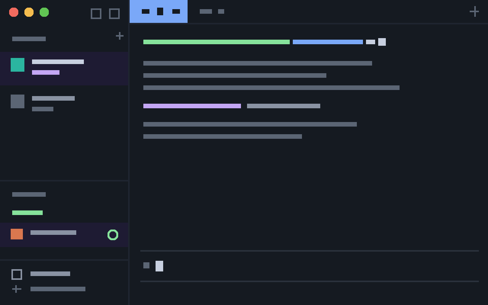

# herdr-layout-cli

A square, text-first layout for the Herdr desktop app. Departure Mono at 13, one dark color, no rounding.



## Install

Needs [Departure Mono](https://departuremono.com) installed. Copy into `~/.config/herdr-app`:

```sh
git clone https://github.com/yych42/herdr-layout-cli /tmp/herdr-layout-cli
cp -R /tmp/herdr-layout-cli/layouts/. ~/.config/herdr-app/layouts/
cp -R /tmp/herdr-layout-cli/themes/.  ~/.config/herdr-app/themes/
cp -R /tmp/herdr-layout-cli/mods/.    ~/.config/herdr-app/mods/
herdr-app do layout.switch '{"name":"cli"}'
```

See `RECIPE.md` for details and limits. Not official.
