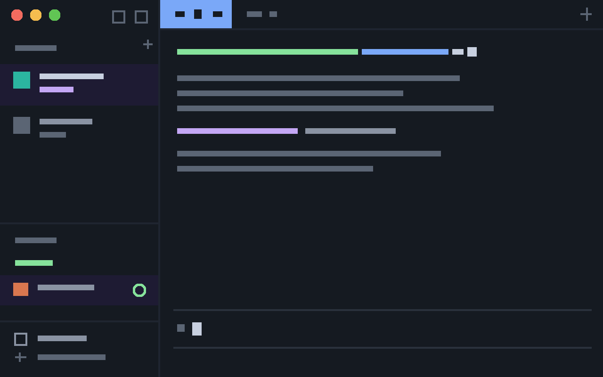

# CLI

A flat, square, text-first layout that makes the Herdr app look like the Herdr terminal UI. One dark color, no rounded corners, Departure Mono at 13 throughout, and solid-color blocks for selection and hover.

## What you see

- **Window:** background `#151a21`, no pane cards, no gaps. Terminals fill the window with 2px / 8px padding. Dividers are 1px `#1f2530`.
- **Left sidebar (220px, `chrome` background):**
  - 32px top row. It holds only the macOS traffic lights (left) and the search and sidebar-toggle buttons (right). There is no logo or name.
  - "Spaces" list with a `+`. The selected space is a full-width block `#1e1b33` with the space name in `#c8d0e0` and the branch in lavender. The list has no side padding.
  - "Agents" list grouped by state, same block selection.
  - 75px footer with 1px top border, 8px top and 10px bottom padding, 16px left padding: Settings and Add machine.
- **Tab bar (32px):** the active tab is a solid accent-blue (`#7aa8f8`) block the full height of the bar, with dark text. Inactive tabs are plain text. There are no gaps and no rounding. The `+` button and the Files/Changes buttons are full-height square blocks, 32px wide.
- **Status bar:** hidden.
- **Pane headers:** 22px, shown only on hover. The focused pane has a 1px accent border.

## How it behaves

- Hover on any button, row or tab is a solid block (`hover` = `#1b2029`), never rounded.
- Agent states: working = green (`#86e29b`) spinner or dot; blocked = yellow (`#f9e2af`); done = green; idle = dim `#5b6574`. Status dots stay round (6px).
- The active tab shows its spinner and close icon in the dark text color.
- Toasts and popups are still framed by Herdr (rounded, shadowed); see Watch out.

## Built from

- `layouts/cli.json`, a clone of the shipped `main` layout. Font keys on the root: `font` and `ui_font` = `Departure Mono`, `font_size` 13, `theme` = `cli`, `terminal_padding` `[2, 8]`. Nodes: `brand` 32px, `sidebar` 220px, `sidebar-footer` 75px, `tabs` 32px, `work-body` padding 0 and gap 0, `status` hidden. Pane frame: gap 0, radius 0, header 22px with `reveal: "hover"`. Dividers use the literal `#1f2530`.
- `themes/cli.json`: background `#151a21`, foreground `#c8d0e0`, accent `#7aa8f8`, panel colors overridden: `chrome`, `canvas`, `surface` = `#151a21`; `raised` and `selected` = `#1e1b33`; `hover` = `#1b2029`; `border` = `#1f2530`; `muted` = `#8a93a3`; `dim` = `#5b6574`.
- Mods: clones of the shipped `spaces`, `agents`, `tabs`, `workspace-chrome`, `menu`, `new-menu`, `pane`, `files`, `changes`, `prompt`, `confirm`, `toast` and `picker`, each named `cli-<name>`, with every `.rounded(n)` of 4 or more removed and `t.border` replaced by `#1f2530`. Their references to each other and the layout's `content.mod` entries use the `cli-` names.
  - `cli-tabs`: active tab `bg(t.accent)` with `t.chrome` text, `h_full()`, `px(14)`, no gap; the root has no padding except the macOS traffic-light inset.
  - `cli-workspace-chrome`: the brand row is an empty spacer plus two 32px-wide, full-height buttons; the footer rows are 28px with `px(16)`.
  - `cli-spaces`: the list container has no side padding.

## Watch out

- **Font:** Departure Mono is not bundled. Install it first (https://departuremono.com); otherwise terminals fall back to JetBrains Mono.
- **Rounded frames you can't remove:** Herdr draws its own frame (border, corner radius, shadow) around toasts, popups and dialogs, and macOS draws the window corners. `frame: "none"` only exists on `openOverlay`, not for the app's own toasts. See herdr-app issues #396 and #684.
- Clones never receive fixes from the shipped mods. Re-clone to pick up updates.
- Built and checked on herdr-app 0.1.13, macOS.
- The `cli-*` mods reference their own icons under `mods/cli-workspace-chrome/`; keep that folder.

## Done when

- `herdr-app check mods/cli-<name>` passes for all 13 mods and `herdr-app status` shows `errors: []`.
- `layout.switch {"name":"cli"}` shows the window with no rounded corners inside the sidebar, tab bar or panes.
- The active tab is a full-height solid blue block, and hovering it or any other tab shows a square block.
- Settings and Add machine are fully visible with space below them.
- Settings → Look shows the `cli` preview.
